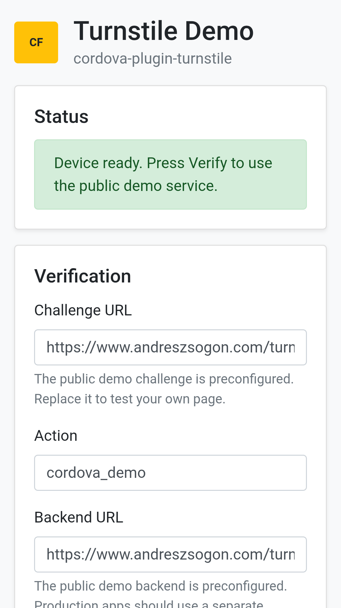
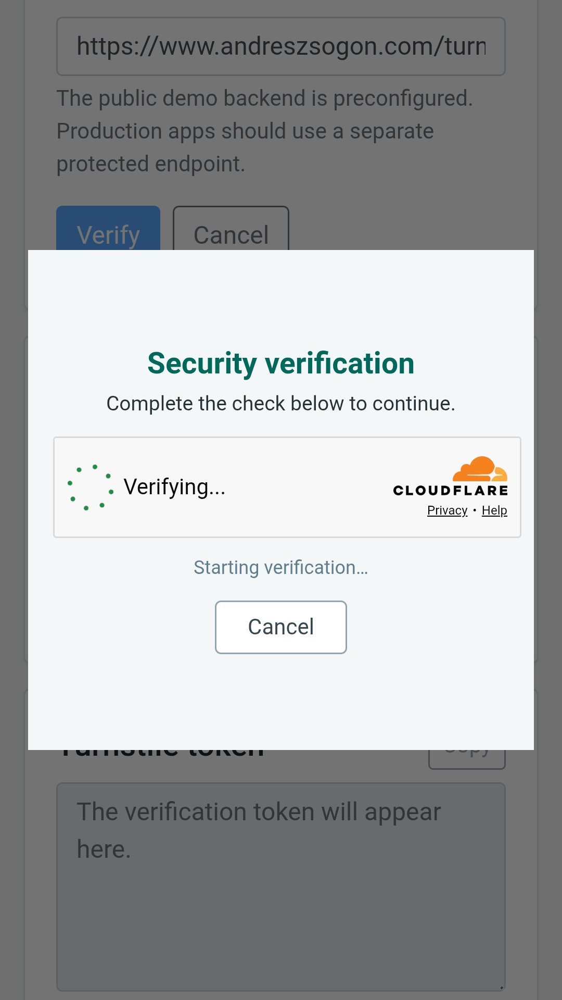

# cordova-plugin-turnstile

A Cordova plugin that runs [Cloudflare Turnstile](https://developers.cloudflare.com/turnstile/) in a secure Android WebView dialog without navigating away from the Cordova screen that requested verification.

The host application provides an HTTPS page that renders the Turnstile widget. During verification, the plugin restricts WebView navigation to that page's host and `challenges.cloudflare.com`, rejects SSL errors and mixed content, and returns only the ephemeral Turnstile token to JavaScript.

## Platform support

- Android
- Cordova 11 or later
- cordova-android 11 or later
- An up-to-date Android System WebView or Chrome installation
- PHP 7.0 or later for the supplied challenge page

The optional backend examples have their own runtime requirements: PHP 5.3 or later with cURL and JSON, Node.js 22 or later, or Python 3.11 or later. See [`server/README.md`](server/README.md).

## Installation

Install directly from GitHub:

```shell
cordova plugin add https://github.com/andreszs/cordova-plugin-turnstile.git
```

When the package is available from npm, it can also be installed with:

```shell
cordova plugin add cordova-plugin-turnstile
```

## Host the verification page

This plugin does not provide or depend on a shared verification service. The developer using the plugin must host a small HTTPS page that renders the Turnstile widget.

### End-to-end verification flow

1. The Cordova app asks the plugin to open your hosted PHP page with an expected action.
2. The page renders the Turnstile widget using your public site key and that action.
3. After the challenge succeeds, Turnstile gives the page a short-lived token.
4. The page publishes the token through `window.cordovaTurnstileResult`.
5. The plugin closes the dialog and returns the token to the app's success callback.
6. The app sends the token to its backend, which submits it to Cloudflare Siteverify with the secret key.
7. The backend accepts the protected request only when Siteverify reports success and the expected hostname and action.

### Complete implementation steps

1. Create a widget in the [Cloudflare Turnstile dashboard](https://dash.cloudflare.com/?to=/:account/turnstile), following the official [widget creation guide](https://developers.cloudflare.com/turnstile/get-started/widget-management/dashboard/), and add every hostname that will serve the challenge page through [Hostname Management](https://developers.cloudflare.com/turnstile/additional-configuration/hostname-management/).
2. Copy the widget's site key and secret key. Review the [widget key concepts](https://developers.cloudflare.com/turnstile/concepts/widget/): the site key is public, while the secret key must remain only in secure backend configuration.
3. Download [`server/turnstile.php`](server/turnstile.php), replace `YOUR_TURNSTILE_SITE_KEY` with the site key, and leave the secret key out of this file.
4. Upload `turnstile.php` to one of the [allowed hostnames](https://developers.cloudflare.com/turnstile/additional-configuration/hostname-management/) over HTTPS and confirm that its TLS certificate is valid on the Android devices you support.
5. Choose an [action](https://developers.cloudflare.com/turnstile/get-started/client-side-rendering/widget-configurations/#custom-data) for each protected operation, such as `login` or `register`. Actions must contain 1-32 letters, numbers, underscores, or hyphens.
6. Test the hosted page in a browser with the action query parameter, for example `https://example.com/turnstile.php?action=register`, and confirm that the widget loads. Refer to Cloudflare's [client-side rendering guide](https://developers.cloudflare.com/turnstile/get-started/client-side-rendering/) if the widget does not render.
7. Implement a backend endpoint that receives the Turnstile token together with the protected request. This endpoint is separate from the hosted challenge page. Start with the complete [PHP, Node.js, or Python/FastAPI examples](server/README.md), then replace the protected-operation placeholder with your application logic.
8. From that backend endpoint, send the token and secret key to Cloudflare's [Siteverify API](https://developers.cloudflare.com/turnstile/get-started/server-side-validation/). Optionally include the user's remote IP when it is available and trustworthy.
9. Reject the protected request unless Siteverify returns `success: true` and the response contains the hostname and action expected for that operation. Use the official [Siteverify response and error reference](https://developers.cloudflare.com/turnstile/get-started/server-side-validation/) and fail closed on network errors, invalid JSON, expired tokens, or duplicate tokens.
10. Use the [Apache Cordova CLI](https://cordova.apache.org/docs/en/latest/reference/cordova-cli/) to add Android and install this plugin from [GitHub](https://github.com/andreszs/cordova-plugin-turnstile) or npm. Use Cordova 11 and cordova-android 11 or later.
11. Allow the backend origin in the Cordova network allowlist and in the app's Content Security Policy, as shown in [Cordova network access and CORS](#cordova-network-access-and-cors).
12. Configure the backend to accept the app's exact Cordova origin and to answer the JSON request's CORS preflight `OPTIONS` request. Do not use `Access-Control-Allow-Origin: *` in production.
13. Wait for Cordova's [`deviceready` event](https://cordova.apache.org/docs/en/latest/cordova/events/events.html#deviceready) before accessing `cordova.plugins.turnstile`.
14. Call [`cordova.plugins.turnstile.verify()`](#usage) with the full HTTPS challenge-page URL and the expected action. The URL's `action` query parameter must exactly match the `action` option.
15. In the success callback, immediately send the returned token and the protected-operation data to the separate backend URL. The backend must validate the token and perform the protected operation in that same request.
16. In the error callback, handle the plugin's [documented error codes](#error-codes) and let the user retry when appropriate. Do not silently bypass verification after an error.
17. Use [`cancel()`](#cancel-an-active-verification) when the application needs to stop an active challenge. If the [optional badge](#optional-badge) is used, call `showBadge()` only where it is relevant and `hideBadge()` when leaving that screen.
18. Follow Cloudflare's [Turnstile testing guide](https://developers.cloudflare.com/turnstile/troubleshooting/testing/) and test successful verification, user cancellation, timeout, expiration, invalid actions, hostname/action mismatches, reused tokens, offline behavior, TLS failures, CORS failures, and simultaneous verification attempts before releasing the application.
19. In production, follow Cloudflare's [server-side validation guidance](https://developers.cloudflare.com/turnstile/get-started/server-side-validation/): keep both endpoints on HTTPS, keep secrets out of the app and repository, avoid logging complete tokens, and process every token as short-lived and single-use.

The challenge page and the backend validation endpoint have different responsibilities:

| Value | Where it belongs |
| --- | --- |
| Turnstile site key | The hosted PHP challenge page. It is public. |
| Turnstile secret key | Your backend validation endpoint only. It must never be included in the app or challenge page. |
| Verification token | Returned to the app and sent immediately to your backend. |

### Cordova network access and CORS

The plugin loads the challenge page in its own restricted native WebView. The request that sends the returned token to your backend is made by the main Cordova WebView and must be allowed separately.

Allow only your backend origin in the app's `config.xml`:

```xml
<access origin="https://api.example.com" />
```

Add the same backend to the `connect-src` directive in every Cordova HTML page that performs the request:

```html
<meta http-equiv="Content-Security-Policy"
      content="default-src 'self' data: https://ssl.gstatic.com; connect-src 'self' https://api.example.com; style-src 'self'; img-src 'self' data: content:">
```

cordova-android serves the app from `https://localhost` by default. A backend receiving JSON from that origin must return these headers and answer `OPTIONS` with no protected operation:

```http
Access-Control-Allow-Origin: https://localhost
Vary: Origin
Access-Control-Allow-Methods: POST, OPTIONS
Access-Control-Allow-Headers: Content-Type
```

If the Cordova `scheme` or `hostname` preference is changed, allow the resulting exact origin instead. The supplied backend examples use the `CORDOVA_ALLOWED_ORIGIN` environment variable and include preflight handling. CORS does not replace authentication or authorization.

### Deploy the supplied PHP page

1. Create a Turnstile widget in Cloudflare and allow the hostname where the page will be uploaded.
2. [Download the complete `turnstile.php` example](https://raw.githubusercontent.com/andreszs/cordova-plugin-turnstile/main/server/turnstile.php), or copy [`server/turnstile.php`](server/turnstile.php) from this package.
3. Replace `YOUR_TURNSTILE_SITE_KEY` with your public Turnstile site key.
4. Upload the file to your own HTTPS server, for example `https://example.com/turnstile.php`.
5. Test it in a browser with a valid action, for example `https://example.com/turnstile.php?action=register`.
6. Pass that same URL and action to `cordova.plugins.turnstile.verify()`.

The `action` query parameter is required. It must contain 1-32 letters, numbers, underscores, or hyphens, and must exactly match the `action` passed to the plugin.

```javascript
cordova.plugins.turnstile.verify({
    url: 'https://example.com/turnstile.php?action=register',
    action: 'register'
}, onSuccess, onError);
```

The supplied PHP page is ready to upload after setting the site key. It requires PHP 7.0 or later but no framework, database, secret key, or other files from this repository. The separate PHP backend validator remains compatible with PHP 5.3 or later when cURL and JSON are enabled.

### Complete PHP example

<details>
<summary>Show the complete <code>turnstile.php</code> file</summary>

```php
<?php
declare(strict_types=1);

/*
 * Self-hosted challenge page for cordova-plugin-turnstile.
 *
 * 1. Replace the value below with your public Cloudflare Turnstile site key.
 * 2. Upload this file to an HTTPS server allowed by your Turnstile widget.
 * 3. Open it through the plugin with a matching action query parameter:
 *    https://example.com/turnstile.php?action=register
 *
 * Never place your Turnstile secret key in this file.
 * Requires PHP 7.0 or later.
 */
$turnstileSiteKey = 'YOUR_TURNSTILE_SITE_KEY';

// The URL action must exactly match the action passed to plugin.verify().
$action = isset($_GET['action']) && is_string($_GET['action'])
    ? $_GET['action']
    : '';

if (!preg_match('/^[A-Za-z0-9_-]{1,32}$/', $action)) {
    http_response_code(400);
    exit('Invalid action.');
}

if ($turnstileSiteKey === 'YOUR_TURNSTILE_SITE_KEY'
    || !preg_match('/^[A-Za-z0-9_-]{20,32}$/', $turnstileSiteKey)) {
    http_response_code(503);
    exit('Configure a valid Cloudflare Turnstile site key before using this page.');
}

// Restrict this page to the resources required by the Turnstile widget.
$nonce = rtrim(strtr(base64_encode(random_bytes(18)), '+/', '-_'), '=');
$csp = "default-src 'none'; "
    ."script-src 'nonce-$nonce' 'strict-dynamic' https://challenges.cloudflare.com; "
    ."frame-src https://challenges.cloudflare.com; "
    ."connect-src https://challenges.cloudflare.com; "
    ."style-src 'nonce-$nonce'; img-src data:; base-uri 'none'; form-action 'none'; frame-ancestors 'none'";

header('Content-Type: text/html; charset=UTF-8');
header('Content-Security-Policy: '.$csp);
header('Referrer-Policy: no-referrer');
header('X-Content-Type-Options: nosniff');
header('Cache-Control: no-store, max-age=0');
header('Pragma: no-cache');
?>
<!doctype html>
<html lang="en">
<head>
    <meta charset="utf-8">
    <meta name="viewport" content="width=device-width,initial-scale=1,maximum-scale=1,user-scalable=no">
    <title>Security verification</title>
    <style nonce="<?=htmlspecialchars($nonce, ENT_QUOTES, 'UTF-8')?>">
        *{box-sizing:border-box}
        html,body{background:#f4f7f8;color:#263238;font-family:Arial,sans-serif;height:100%;margin:0}
        main{align-items:center;display:flex;flex-direction:column;justify-content:center;min-height:100%;padding:16px;text-align:center}
        h1{color:#00695c;font-size:19px;margin:0 0 6px}
        p{font-size:13px;line-height:1.35;margin:0 0 12px;max-width:320px}
        #turnstile-widget{max-width:320px;min-height:65px;width:100%}
        #status{color:#607d8b;font-size:12px;margin-top:8px;min-height:16px}
        button{background:#fff;border:1px solid #90a4ae;border-radius:4px;color:#37474f;font-size:14px;margin-top:12px;padding:8px 20px}
    </style>
    <script nonce="<?=htmlspecialchars($nonce, ENT_QUOTES, 'UTF-8')?>">
        'use strict';
        var cordovaTurnstileAction = <?=json_encode($action, JSON_UNESCAPED_SLASHES)?>;
        var cordovaTurnstileSiteKey = <?=json_encode($turnstileSiteKey, JSON_UNESCAPED_SLASHES)?>;

        function sendResult(payload) {
            // The Android plugin polls this variable and consumes it once.
            window.cordovaTurnstileResult = payload;
        }

        function onTurnstileLoad() {
            turnstile.render('#turnstile-widget', {
                sitekey: cordovaTurnstileSiteKey,
                action: cordovaTurnstileAction,
                appearance: 'always',
                execution: 'render',
                size: 'flexible',
                theme: 'light',
                language: 'auto',
                callback: function (token) {
                    document.getElementById('status').textContent = 'Verification completed.';
                    sendResult({
                        type: 'turnstile',
                        status: 'success',
                        action: cordovaTurnstileAction,
                        token: token
                    });
                },
                'error-callback': function (code) {
                    document.getElementById('status').textContent = 'Cloudflare error: ' + String(code || 'unknown');
                    sendResult({
                        type: 'turnstile',
                        status: 'error',
                        action: cordovaTurnstileAction,
                        code: String(code || '')
                    });
                },
                'expired-callback': function () {
                    sendResult({
                        type: 'turnstile',
                        status: 'expired',
                        action: cordovaTurnstileAction
                    });
                },
                'timeout-callback': function () {
                    sendResult({
                        type: 'turnstile',
                        status: 'timeout',
                        action: cordovaTurnstileAction
                    });
                }
            });
        }

        document.addEventListener('DOMContentLoaded', function () {
            document.getElementById('cancel-button').addEventListener('click', function () {
                sendResult({
                    type: 'turnstile',
                    status: 'cancel',
                    action: cordovaTurnstileAction
                });
            });
        });
    </script>
    <script nonce="<?=htmlspecialchars($nonce, ENT_QUOTES, 'UTF-8')?>" src="https://challenges.cloudflare.com/turnstile/v0/api.js?render=explicit&amp;onload=onTurnstileLoad" defer></script>
</head>
<body>
<main>
    <h1>Security verification</h1>
    <p>Complete the check below to continue.</p>
    <div id="turnstile-widget"></div>
    <div id="status">Starting verification…</div>
    <button type="button" id="cancel-button">Cancel</button>
</main>
</body>
</html>
```

</details>

If the page returns HTTP 400, check the `action` parameter. If it returns HTTP 503, the site key is still missing or has an invalid format.

The site-key check accepts both production keys and Cloudflare's official `1x`, `2x`, and `3x` test sitekeys. Test sitekeys must be paired with the matching test secret key; production secrets reject dummy tokens and test secrets reject real tokens.

## Usage

Wait for `deviceready`, then call `verify` with the URL of your HTTPS Turnstile challenge page and the expected action.

The challenge URL must:

- Use HTTPS with a certificate accepted by every supported Android device.
- Include a non-empty path, such as `/turnstile.php`.
- Include an `action` query parameter that exactly matches the `action` option.
- Finish loading on the same hostname and path. Redirects to another path do not start result polling and will eventually time out.

Send the token to a separate backend URL. This complete example assumes that the backend origin has already been added to the Cordova allowlist and CSP and that its CORS policy accepts the Cordova app origin:

```javascript
var TURNSTILE_PAGE_URL = 'https://verify.example.com/turnstile.php?action=register';
var BACKEND_URL = 'https://api.example.com/register';

cordova.plugins.turnstile.verify(
    {
        url: TURNSTILE_PAGE_URL,
        action: 'register'
    },
    function (token) {
        fetch(BACKEND_URL, {
            method: 'POST',
            headers: {'Content-Type': 'application/json'},
            body: JSON.stringify({
                turnstileToken: token,
                payload: {
                    email: document.getElementById('email').value
                }
            })
        }).then(function (response) {
            return response.json().then(function (body) {
                if (!response.ok || body.ok !== true) {
                    throw new Error(body.message || 'The protected request was rejected.');
                }
                return body;
            });
        }).then(function () {
            console.log('The backend validated Turnstile and completed the operation.');
        }).catch(function (error) {
            console.error(error.message);
        });
    },
    function (errorCode) {
        console.error('Turnstile verification failed:', errorCode);
    }
);
```

Only letters, numbers, underscores, and hyphens are accepted in the action, with a maximum length of 32 characters.

Do not validate the token in one request and perform the protected operation in a later unprotected request. Siteverify validation and the protected operation belong in the same authenticated and authorized backend handler.

### JavaScript API

| Method | Parameters | Result |
| --- | --- | --- |
| `verify(options, success, error)` | `options.url` and `options.action` are required. | Returns the token to `success(token)`. Only one verification may run at a time. |
| `cancel(success, error)` | No options. | Closes an active challenge. The active `verify` error callback receives `cancel`; the `cancel` call itself succeeds after requesting cancellation. |
| `showBadge(options, success, error)` | Optional `label`, `detail`, and `position`. | Shows or replaces the native informational badge. |
| `hideBadge(success, error)` | No options. | Removes the badge if present. |

`showBadge` defaults to `Protected by Turnstile`, `Privacy · Help`, and `bottomright`. `position` accepts `bottomright` or `bottomleft`; `label` and `detail` are limited to 80 characters each. The badge is informational and does not replace the challenge or Siteverify.

### Remote page contract

The HTTPS page that renders Turnstile must publish the challenge result through `window.cordovaTurnstileResult`. A successful result has the following shape:

```javascript
window.cordovaTurnstileResult = {
    type: 'turnstile',
    status: 'success',
    action: 'register',
    token: token
};
```

The `action` value must match the action passed to `verify`. Supported non-success statuses include `cancel`, `expired`, and `timeout`; any other status is reported as the generic `challenge_error`. The plugin does not currently expose Cloudflare's detailed client-side error code to the Cordova callback; use Cloudflare's [client-side error reference](https://developers.cloudflare.com/turnstile/troubleshooting/client-side-errors/error-codes/) while diagnosing the hosted page.

### Cancel an active verification

```javascript
cordova.plugins.turnstile.cancel(
    function () {
        console.log('Verification cancelled.');
    },
    function (errorCode) {
        console.error(errorCode);
    }
);
```

### Optional badge

The plugin can display a compact, expandable informational badge over the Cordova activity:

```javascript
cordova.plugins.turnstile.showBadge({
    label: 'Protected by Turnstile',
    detail: 'Privacy · Help',
    position: 'bottomright'
});

cordova.plugins.turnstile.hideBadge();
```

`position` accepts `bottomright` or `bottomleft`. The label and detail are each limited to 80 characters.

## Error codes

The error callback may receive one of these string codes:

| Code | Meaning |
| --- | --- |
| `already_running` | Another verification is already active. |
| `cancel` | The user or application cancelled verification. |
| `challenge_error` | The remote page reported an unsuccessful challenge. |
| `expired` | The challenge or token expired. |
| `invalid_options` | The URL or action is missing or invalid. |
| `invalid_response` | The remote page returned an unreadable result. |
| `invalid_token` | The returned token did not pass basic length validation. |
| `load_error` | The verification page failed to load. |
| `ssl_error` | Android rejected the page's TLS certificate. |
| `timeout` | Verification did not complete within 120 seconds. |

## Server-side validation

A token returned by this plugin is not proof of successful verification by itself. Send it to your backend immediately and validate it with Cloudflare's Siteverify API. Keep the Turnstile secret key on the server; never embed it in the Cordova application or the remote challenge page.

The backend should also verify the expected hostname and action in the Siteverify response before accepting the request. Turnstile tokens are single-use and expire after a short period.

Complete, runnable backend examples are included for [PHP, Node.js, and Python with FastAPI](server/README.md). They all use the same request contract, keep the expected hostname and action in server configuration, fail closed, and execute the protected-operation placeholder only after successful validation.

See the [Cloudflare server-side validation documentation](https://developers.cloudflare.com/turnstile/get-started/server-side-validation/) for the required request and response handling.

If a backend retries a Siteverify request after a network failure, generate one UUID and send it as `idempotency_key` on every attempt for that validation. Reusing the same idempotency key makes the retry safe; generating a new key for each attempt defeats that protection. The supplied examples do not retry automatically and therefore do not send this optional field.

### Testing and environments

- Use Cloudflare's [official test sitekeys and secret keys](https://developers.cloudflare.com/turnstile/troubleshooting/testing/) for predictable success, failure, interactive, and duplicate-token tests. Never deploy test credentials to production.
- Use separate widgets and secrets for development, staging, and production. Restrict every production widget to hostnames you control.
- Test the complete request, including the app's CSP and allowlist, the CORS preflight, Siteverify, hostname/action checks, authentication, authorization, and the protected operation.
- Rotate an exposed or committed secret immediately using Cloudflare's [secret rotation procedure](https://developers.cloudflare.com/turnstile/troubleshooting/rotate-secret-key/), then update the backend environment configuration. Never place the replacement in source control.

## Security notes

- Only HTTPS verification URLs are accepted.
- File and content access are disabled in the verification WebView.
- Mixed HTTP/HTTPS content is rejected.
- SSL errors are never bypassed.
- Navigation is restricted to the initial page's host and `challenges.cloudflare.com`.
- Only one verification can run at a time.
- Keep Android System WebView or Chrome updated on supported devices.
- The hosted page CSP must continue to allow scripts, frames, and connections to `https://challenges.cloudflare.com`.

## License

This project is licensed under the MIT License. See [LICENSE](LICENSE).

Cloudflare, the Cloudflare logo, and Cloudflare Turnstile are trademarks of Cloudflare, Inc. This project is not affiliated with or endorsed by Cloudflare, Inc.

## Demo application

The Cordova demo source files and its precompiled test APK are available in the [cordova-plugin-demos repository](https://github.com/andreszs/cordova-plugin-demos/tree/main/com.andreszs.turnstile.demo).

The source contains no preconfigured endpoint URLs or Turnstile keys. Developers provide separate challenge and backend URLs when building the app. The [precompiled Android APK](https://github.com/andreszs/cordova-plugin-demos/raw/main/com.andreszs.turnstile.demo/com.andreszs.turnstile.demo.apk) uses a public demo-only service that combines both routes for immediate testing; production applications should preserve the separation documented above.

<p align="center">
  
  
  
</p>
